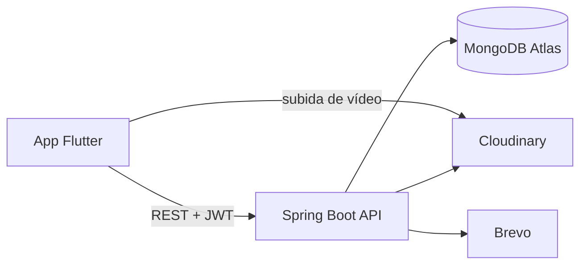

# GoDare API

API REST de **GoDare**, una app social de retos de fitness: los usuarios reciben retos, los completan grabándose en vídeo, la comunidad vota si son válidos y suben de rango.

Proyecto del CFGS **Desarrollo de Aplicaciones Multiplataforma (DAM)** · Nota: **9,4 / 10**

App móvil (Flutter): [kreatimes/Godare](https://github.com/kreatimes/Godare)

## Stack

- **Java 21** · **Spring Boot 3.5** (Web, Security, Data MongoDB, Actuator)
- **MongoDB Atlas**
- **JWT** (jjwt) para autenticación sin estado
- **Cloudinary** para vídeos e imágenes
- **Brevo** para emails transaccionales (verificación de cuenta y recuperación de contraseña)
- **springdoc-openapi** (Swagger UI)
- Despliegue en **Railway**

## Arquitectura



Capas clásicas: `controller` → `service` → `repository`, con DTOs de entrada y salida y un `GlobalExceptionHandler` que devuelve errores homogéneos.

```
src/main/java/com/godare/app
├── config/       Seguridad, Cloudinary, OpenAPI
├── controller/   Endpoints REST
├── dto/          Peticiones y respuestas
├── entity/       Documentos de MongoDB
├── exception/    Errores y manejador global
├── repository/   Spring Data MongoDB
├── security/     Filtro JWT y UserDetailsService
└── service/      Lógica de negocio y tareas programadas
```

## Funcionalidades

**Usuarios**
- Registro, login con JWT, verificación por email, recuperación y cambio de contraseña
- Perfiles, seguidores y seguidos, búsqueda de usuarios y borrado de cuenta

**Retos**
- Ciclo de vida de cada reto: `CLOSED` → `OPEN` → completado con vídeo
- **Reto diario** asignado automáticamente (selección aleatoria con `$sample` de MongoDB, sin cargar el catálogo en memoria)
- **Tienda de packs**: se compran con monedas y generan retos sin repetir
- **Transferencia** de retos a otros usuarios, con notificación
- Los retos caducan a los 7 días si no se completan

**Feed y comunidad**
- Feed global y de seguidos con **paginación por cursor** (`createdAt` + `_id`, estable aunque haya posts del mismo instante)
- Reacciones, comentarios y reportes de contenido
- **Veredicto de la comunidad**: una tarea programada cierra la votación a los 5 días y marca el reto como fallido si la comunidad lo rechaza

**Gamificación**
- Puntos y monedas por reto completado, con historial auditable
- Rangos por puntos y notificación al subir de rango
- Ranking global y entre seguidos

**Mantenimiento automático**
- Los posts caducan a los 7 días mediante **índice TTL** de MongoDB
- Una tarea programada borra antes los archivos de Cloudinary para no dejar archivos huérfanos
- Los índices de MongoDB se crean al arrancar (nick y email únicos, consultas por propietario y estado, notificaciones no leídas…)

## Ejecutar en local

Requisitos: Java 21 y una base de datos MongoDB (local o Atlas).

1. Copia `.env.example` y rellena tus valores (MongoDB, JWT, Cloudinary y Brevo). Ningún secreto está en el repositorio: todo se lee de variables de entorno.
2. Exporta las variables y arranca:

```bash
./mvnw spring-boot:run
```

3. Documentación interactiva de la API: `http://localhost:8080/swagger-ui.html`

## Autor

**Felipe López Escarpa** · Cofundador de Dev-licius · [Apps en Google Play](https://play.google.com/store/search?q=devlicius&c=apps)
